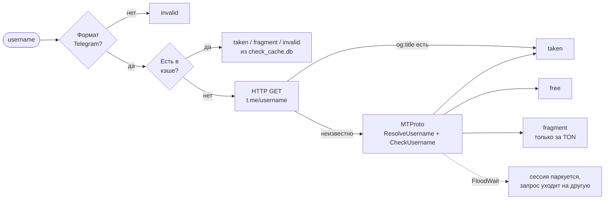

<div align="center">


### Telegram Username Finder

Находит свободные короткие и красивые `@username` в Telegram — честно, через MTProto,
без скрапинга и капчи. Закрытая бета с белым списком, квотами и мониторингом.


**Бот:** [@userneed_bot](https://t.me/userneed_bot) · **Канал:** [@userneed](https://t.me/userneed) · **Архитектура:** [PROJECT.md](PROJECT.md)

</div>

---

## Оглавление

- [Как это работает](#как-это-работает)
- [Возможности](#возможности)
- [Быстрый старт](#быстрый-старт)
- [Конфигурация](#конфигурация)
- [Команды](#команды)
- [Квота и лимиты](#квота-и-лимиты)
- [Архитектура](#архитектура)
- [Данные, безопасность, бэкапы](#данные-безопасность-бэкапы)
- [Эксплуатация и диагностика](#эксплуатация-и-диагностика)
- [Разработка](#разработка)
- [Что нового в этой ревизии](#что-нового-в-этой-ревизии)

---

## Как это работает

Каждый кандидат проходит воронку — от дешёвых проверок к дорогим. До MTProto
доходит лишь малая часть имён, поэтому пул аккаунтов почти не ловит FloodWait.



| Статус | Значение |
|---|---|
| `free` | можно занять прямо сейчас |
| `fragment` | имя существует только на Fragment (за TON) — бесплатно не занять |
| `taken` | занято |
| `invalid` | не проходит формат Telegram (5–32 символа, латиница/цифры/`_`) |
| `error` | проверить не удалось (сеть, неизвестная ошибка) — не кэшируется |

Поверх воронки:

- **Round-Robin** между Telethon-аккаунтами, пауза `CHECK_DELAY_MIN..MAX` — **пер-сессия**, не глобальная.
- **FloodWait паркует только одну сессию**, остальные продолжают. Если на паузе все — прогон
  завершается с частичным результатом, а сеанс пользователю **не списывается**.
- **Кэш вердиктов**: `taken` — 24 ч, `fragment` — 12 ч, `invalid` — 7 дней. `free` не кэшируется никогда.

---

## Возможности

| | |
|---|---|
| 🎲 **Генератор** | пять стратегий: слоговые (`vitoz`), словарные (`storm`), брендовые (`zenix`), служебные (`v_max`), случайные (`kxvzq`). Приоритет редких букв `q z x j w` — там свободных имён в 5–10 раз больше |
| 🧭 **«Похожие на …»** | детерминированные вариации от вашей базы: замены букв, суффиксы, перестановки. Кнопка «↻ Похожие» — прямо под находками в отчёте |
| ⭐ **Скоринг 1–10** | читаемость, длина, ритм, повторы; имена ниже `FILTER_MIN_SCORE` не показываются |
| 📋 **Пакетная проверка** | до 200 имён за раз, живой прогресс-бар, кнопка «Прервать», отчёт по группам free / fragment / taken / invalid |
| 🎟 **Квота** | `USAGE_LIMIT` сеансов на участника в SQLite — переживает рестарт, списывается **только после** успешного прогона; операторы выдают добавку командой |
| 🗂 **История находок** | за 7 / 30 дней, экспорт в CSV, отметка «✓ Занял» — занятое больше не предлагается |
| 👀 **Мониторинг** (операторы) | до 2000 имён, волны hot / warm / cold, сигнал админам при освобождении |
| 💬 **Обратная связь** | пользователь пишет из меню, админ отвечает обычным reply — ответ уходит автору; сквозной номер тикета |
| 🛡 **Закрытая бета** | `AccessMiddleware` (outer) режет всё вне белого списка ещё до фильтров; чужим показывается их ID для запроса доступа |
| 🩺 **Самодиагностика** | сторож сессий, суточная сводка, автобэкапы, `/stats` `/sessions` `/today` |

---

## Быстрый старт

```bash
# 1. Окружение
python -m venv .venv
source .venv/bin/activate            # Windows: .venv\Scripts\activate
pip install -r requirements.txt

# 2. Конфиг
cp .env.example .env                 # BOT_TOKEN, API_ID, API_HASH, ADMIN_IDS, ALLOWED_USER_IDS
python -m config                     # печатает сводку и предупреждения — ошибок быть не должно

# 3. Авторизация служебных аккаунтов (по одному на каждое имя из SESSION_NAMES)
python qr_login.py acc1              # сканируете QR с телефона: Настройки → Устройства
python qr_login.py acc2

# 4. Запуск
python main.py
```

> **Важно.** `BETA_MODE=1` включён по умолчанию: бот отвечает только ID из `ADMIN_IDS`
> и `ALLOWED_USER_IDS`. Если whitelist пуст, бот ответит только администраторам —
> и предупредит об этом в логе при старте.

Где взять данные:

| Ключ | Откуда |
|---|---|
| `BOT_TOKEN` | [@BotFather](https://t.me/BotFather) → `/newbot` |
| `API_ID`, `API_HASH` | <https://my.telegram.org> → API development tools |
| `ADMIN_IDS`, `ALLOWED_USER_IDS` | числовые Telegram ID (например, через [@userinfobot](https://t.me/userinfobot)); бот сам показывает ID тем, кому отказал в доступе |

---

## Конфигурация

Все параметры читаются из `.env` **рядом с `config.py`** (запускать можно из любой папки).
Полный образец с комментариями — [`.env.example`](.env.example).

<details>
<summary><b>Все ключи и значения по умолчанию</b></summary>

| Ключ | По умолчанию | Назначение |
|---|---|---|
| **Обязательные** | | |
| `BOT_TOKEN` | — | токен бота |
| `API_ID`, `API_HASH` | — | ключи MTProto-приложения |
| **Доступ** | | |
| `ADMIN_IDS` | пусто | операторы: безлимит, мониторинг, админ-команды |
| `BETA_MODE` | `1` | `1` — только whitelist, `0` — открыт всем |
| `ALLOWED_USER_IDS` | пусто | whitelist через запятую |
| `USAGE_LIMIT` | `3` | сеансов на участника (генерация или пакетная проверка) |
| **Telethon** | | |
| `SESSION_NAMES` | `acc1,acc2` | имена файлов сессий |
| **Чекер** | | |
| `CHECK_CONCURRENCY` | `4` | параллельных проверок |
| `CHECK_DELAY_MIN` / `MAX` | `1.5` / `3.0` | пауза между запросами одной сессии, сек |
| `FLOOD_COOLDOWN_EXTRA` | `3` | запас к FloodWait, сек |
| `FLOOD_PARK_THRESHOLD` | `300` | порог «длинной» парковки |
| `HTTP_PRECHECK_ENABLED` | `1` | отсев через `t.me` перед MTProto |
| **Генерация** | | |
| `GLOBAL_GEN_CONCURRENCY` | `1` | одновременных прогонов на всю систему (не трогать) |
| `GEN_MAX_SMART` | `10` (3..30) | потолок объёма для осмысленных и похожих |
| `GEN_MAX_RANDOM` | `20` (5..50) | потолок объёма для случайных |
| `GEN_BUSY_RETRY_HINT` | `45` | «повторите через N сек» при занятой очереди |
| `USE_EXTERNAL_DICT` | `1` | словари из `assets/` |
| `SIMILAR_MAX_RESULTS` | `20` | кандидатов в режиме «похожие» |
| `FILTER_MIN_SCORE` | `3` (1..10) | минимальная оценка для показа |
| **Хранилище** | | |
| `STORAGE_ENABLED` | `1` | история находок |
| `FOUND_HISTORY_DAYS` | `30` | срок хранения находок |
| `DATA_DIR` | корень проекта | где лежат `*.db`, `*.session`, `logs/`, `backups/` |
| **Watchlist** | | |
| `WATCH_HOT_INTERVAL` | `3600` | цель моложе 1 дня: раз в час |
| `WATCH_WARM_INTERVAL` | `14400` | моложе 7 дней: раз в 4 часа |
| `WATCH_COLD_INTERVAL` | `86400` | старше: раз в сутки |
| `WATCH_BATCH_SIZE` | `30` | имён за волну |
| `WATCH_SLEEP_AFTER_DAYS` | `20` | `taken` без изменений N дней → в архив |
| **Бэкапы** | | |
| `BACKUP_INCLUDE_SECRETS` | `0` | `1` — класть `.env` и `*.session` в zip (**архив не шифруется**) |
| **Брендинг** | | |
| `BANNER_PATH` | `assets/banner.png` | картинка для `/start`: путь или URL, пусто — без баннера |

Значения с диапазонами ограничиваются автоматически: в `.env` нельзя случайно поставить
интервал мониторинга в 1 секунду или 0 параллельных проверок.

</details>

---

## Команды

| Команда | Кто | Что делает |
|---|---|---|
| `/start` | все | панель управления |
| `/help` | все | регламент |
| `/found` | все | история находок за 30 дней |
| `/cancel` | все | сбросить текущий ввод / остановить прогон |
| `/stats` | операторы | состояние сервиса: сессии, счётчики, базы, кэш |
| `/sessions` | операторы | состояние каждой Telethon-сессии |
| `/today` | операторы | статистика за сутки |
| `/feedback` | операторы | последние 20 обращений |
| `/quota <id>` | операторы | квота пользователя |
| `/quota_reset <id>` | операторы | обнулить использованные сеансы (бонусы сохраняются) |
| `/quota_add <id> <n>` | операторы | выдать `n` дополнительных сеансов |
| `/report_now` | операторы | суточная сводка прямо сейчас |
| `/backup_now` | операторы | бэкап прямо сейчас |

Меню команд в клиенте Telegram у операторов расширенное, у пользователей — базовое.

---

## Квота и лимиты

| Параметр | Значение |
|---|---|
| Сеансов на участника | `USAGE_LIMIT` (по умолчанию 3) + выданные через `/quota_add` |
| Операторы | без ограничений |
| Имён за пакетную проверку | 200 |
| Объём генерации | до `GEN_MAX_SMART` / `GEN_MAX_RANDOM` |
| Прогонов на пользователя | 1 одновременно |
| Прогонов на всю систему | `GLOBAL_GEN_CONCURRENCY` = 1 — иначе пул уходит в FloodWait |
| Мягкий лимит прогона | 14 мин — прогон сворачивается сам и показывает, что успел |
| Жёсткий таймаут | 15 мин — семафор освобождается принудительно |
| Обращений в поддержку | 3 в час |
| Позиций в мониторинге | 2000 |

**Когда сеанс списывается** — ровно один раз и только после работы:

| Исход прогона | Сеанс |
|---|---|
| Завершился штатно (нашёл / не нашёл, но проверял) | списан |
| Остановлен кнопкой «Прервать» | списан — результат показан |
| Сработал мягкий лимит (14 мин) | списан — частичный результат показан |
| Очередь занята другим пользователем | **не списан** |
| Все сессии на паузе (FloodWait) | **не списан**, частичный результат показан |
| Жёсткий таймаут, внутренняя ошибка, 0 проверок | **не списан** |

---

## Архитектура

```
userneed/
├── main.py                # точка входа: AsyncExitStack, пул Telethon, aiogram, фоновые сервисы
├── config.py              # .env → frozen Config, runtime_warnings(), DATA_DIR и производные пути
├── qr_login.py            # QR-авторизация Telethon-сессий
├── bot/
│   ├── handlers.py        # хендлеры, FSM, middleware, обвязка прогона _start_run
│   ├── keyboards.py       # inline-клавиатуры
│   ├── branding.py        # ВСЕ тексты бота (HTML, экранирование внутри)
│   └── utils.py           # esc, progress_bar, chunk_lines
├── services/
│   ├── checker.py         # мульти-сессионный чекер: формат → кэш → HTTP → MTProto, антифлуд
│   ├── generator.py       # пять стратегий, скоринг 1–10, «похожие»
│   ├── quota.py           # квота сеансов                         → quota.db
│   ├── storage.py         # история находок, CSV-экспорт          → found.db
│   ├── check_cache.py     # кэш вердиктов с TTL                   → check_cache.db
│   ├── watchlist.py       # мониторинг имён                       → watchlist.db
│   ├── feedback.py        # обращения и ответы                    → feedback.db
│   ├── sqlite_fsm.py      # FSM-storage aiogram                   → fsm.db
│   ├── session_guard.py   # сторож сессий
│   ├── daily_report.py    # суточная сводка
│   └── backup_manager.py  # бэкапы с ротацией
└── assets/                # banner.png, words.txt, words_5.txt, names.txt, stopwords.txt
```

**Жизненный цикл прогона** (генерация и пакетная проверка идут через одну обвязку):

```
лимит не исчерпан → у пользователя нет активного прогона → слот зарезервирован
→ глобальный семафор свободен → wait_for(body, 900 с) → run.commit() → слот освобождён
```

**Фоновые сервисы** (все — задачи в том же event loop, останавливаются через `AsyncExitStack`):

| Сервис | Период | Что делает |
|---|---|---|
| `Watchlist` | hot 1 ч / warm 4 ч / cold 24 ч | проверяет цели волнами по 30, сообщает админам об освобождении |
| `SessionGuard` | 30 мин | `is_user_authorized` → реконнект → один алерт в час, если не помогло |
| `DailyReporter` | 24 ч | находки, уникальные пользователи, дельты чекера, сессии, watchlist |
| `BackupManager` | 24 ч | консистентный снимок баз через `sqlite3.backup()`, ротация 14 дней / 20 архивов |

**Шесть баз SQLite** в `DATA_DIR` — Redis не нужен:

| Файл | Что хранит | Очистка |
|---|---|---|
| `found.db` | находки: пользователь, имя, оценка, режим, «занял» | `FOUND_HISTORY_DAYS` |
| `quota.db` | использованные сеансы и бонусы | вручную (`/quota_reset`) |
| `check_cache.db` | вердикты `taken` / `fragment` / `invalid` | TTL + 7 дней |
| `watchlist.db` | цели мониторинга, статусы, расписание | архив по `WATCH_SLEEP_AFTER_DAYS` |
| `feedback.db` | обращения, ответы, статусы тикетов | 90 дней |
| `fsm.db` | состояния диалогов aiogram | 7 дней без активности |

Принципы, которые нельзя менять без обсуждения (HTML-разметка, пер-сессионные паузы,
HTTP до MTProto, семафор = 1, квота после работы и т. д.) — в [PROJECT.md](PROJECT.md).

---

## Данные, безопасность, бэкапы

- Всё состояние — в `DATA_DIR` (по умолчанию корень проекта): `*.db`, `*.session`,
  `logs/`, `backups/`, `last_report.txt`. Переезд на другой сервер = копия этой папки и `.env`.
- `.gitignore` закрывает `.env`, `*.session*`, `*.db*`, `logs/`, `backups/`, `qr_*.png`.
  Если что-то из этого уже попало в историю — `git rm --cached`, затем перевыпустите
  `BOT_TOKEN` и завершите сессии в Telegram → Устройства.
- Суточный бэкап содержит базы и `assets/`. **`.env` и `*.session` по умолчанию исключены**:
  zip не шифруется, а эти файлы дают полный доступ к аккаунтам. Включить —
  `BACKUP_INCLUDE_SECRETS=1`; бот напомнит об этом в логе и в каждом уведомлении о бэкапе.
- Сессии восстанавливаются за минуту через `qr_login.py`, поэтому хранить их в архиве не обязательно.
- Логи: `DATA_DIR/logs/userneed.log`, ротация 10 МБ × 5.

---

## Эксплуатация и диагностика

<details>
<summary><b>Бот всем отвечает «доступ закрыт»</b></summary>

`BETA_MODE=1`, а `ALLOWED_USER_IDS` пуст — отвечает только админам. Добавьте ID в whitelist
или выключите бету. `python -m config` показывает это предупреждение до запуска.
</details>

<details>
<summary><b>В логе «Сессия 'acc1' не авторизована»</b></summary>

`python qr_login.py acc1`. Бот не пытается логиниться интерактивно внутри главного процесса —
на сервере без терминала это зависло бы. Пока сессия не авторизована, пул работает на остальных;
если не поднялась ни одна — бот не стартует и говорит почему.
</details>

<details>
<summary><b>«Все сессии на паузе, повторите через N сек»</b></summary>

FloodWait на всех аккаунтах. Сеанс пользователю не списан. Лечится временем; системно —
добавить сессии в `SESSION_NAMES`, поднять `CHECK_DELAY_MIN/MAX`, не трогать `GLOBAL_GEN_CONCURRENCY`.
</details>

<details>
<summary><b>«Система занята, повторите через 45 сек»</b></summary>

Семафор прогонов занят другим пользователем — это норма при `GLOBAL_GEN_CONCURRENCY=1`.
Сеанс не списан. Подсказку по времени задаёт `GEN_BUSY_RETRY_HINT`.
</details>

<details>
<summary><b>Нужно дать пользователю больше попыток</b></summary>

`/quota_add <id> <n>` — добавка хранится отдельно и переживает `/quota_reset`.
Посмотреть текущее состояние — `/quota <id>`.
</details>

<details>
<summary><b>Что показывает /stats</b></summary>

Состояние каждой сессии (жива / припаркована, до когда), счётчики чекера (free / taken / fragment,
HTTP-отсев, попадания в кэш, флуды, ошибки), размер и попадания кэша, базы находок,
разбивка watchlist, число обращений, режим доступа и размер whitelist.
</details>

<details>
<summary><b>Первый запуск после обновления</b></summary>

Один раз сбросятся состояния диалогов (новая схема `fsm.db`) и квота начнётся с нуля
(раньше она и так обнулялась при каждом рестарте). Больше ничего мигрировать не нужно.
</details>

---

## Разработка

```bash
pip install -r requirements.txt
python -m config                     # проверка конфига
python -m pyflakes .                 # статический анализ — должно быть чисто
python -m services.generator         # самопроверка генератора (словари, скоринг, «похожие»)
python main.py
```

Правила кода — в [PROJECT.md](PROJECT.md): type hints, `from __future__ import annotations`,
`logging.getLogger(__name__)` вместо `print`, комментарии на русском, конкретные исключения,
**ни одной пользовательской строки вне `bot/branding.py`**.

Зависимости: `aiogram>=3.7`, `telethon>=1.36`, `aiohttp`, `aiosqlite`, `python-dotenv`, `qrcode[pil]`.

---

## Что нового в этой ревизии

Полная ревизия после код-ревью — 22 файла, безопасность, надёжность и честная квота.

- **Исправлены падения**: отсутствующие импорты Telethon-ошибок в чекере, отсутствующий
  `HELP_TEXT`, бесконечный цикл генерации «похожих» на короткой базе, `qrcode` в зависимостях.
- **Безопасность**: `.env` и `*.session` исключены из бэкапов по умолчанию; «✓ Занял» помечает
  только свои находки; мониторинг только операторам; `AccessMiddleware` стал outer; явные
  предупреждения вместо молчаливой блокировки всех при пустом whitelist.
- **Квота в SQLite** вместо памяти процесса — переживает рестарт, списывается после работы,
  никогда не сгорает на таймауте, флуде или занятой очереди; `/quota`, `/quota_reset`, `/quota_add`.
- **Прогоны**: один на пользователя, общий семафор без гонок, жёсткий 15-минутный таймаут
  плюс мягкий с частичным результатом, остановка через per-run `Event`.
- **Сервисы**: сторож сессий без двойных алертов, watchlist не теряет позиции при ошибках,
  FSM-storage с полным ключом и очисткой, кэш вердиктов с TTL, консистентные бэкапы с ротацией,
  суточная сводка с дельтами.
- **Инфраструктура**: `DATA_DIR`, `AsyncExitStack` для всех ресурсов, ротация логов,
  `.env.example`, расширенный `.gitignore`, `python -m config`.
- **Тексты**: все строки в `branding.py`, HTML экранируется в одном месте, ни одного
  обращения к приватным методам между модулями.

Подробный список изменений — в описании pull request.
